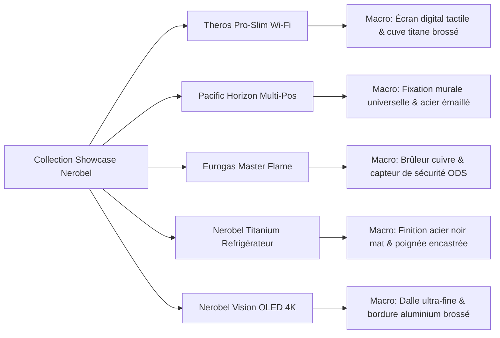
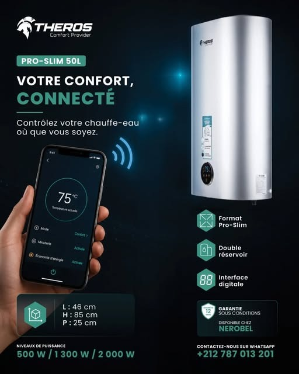
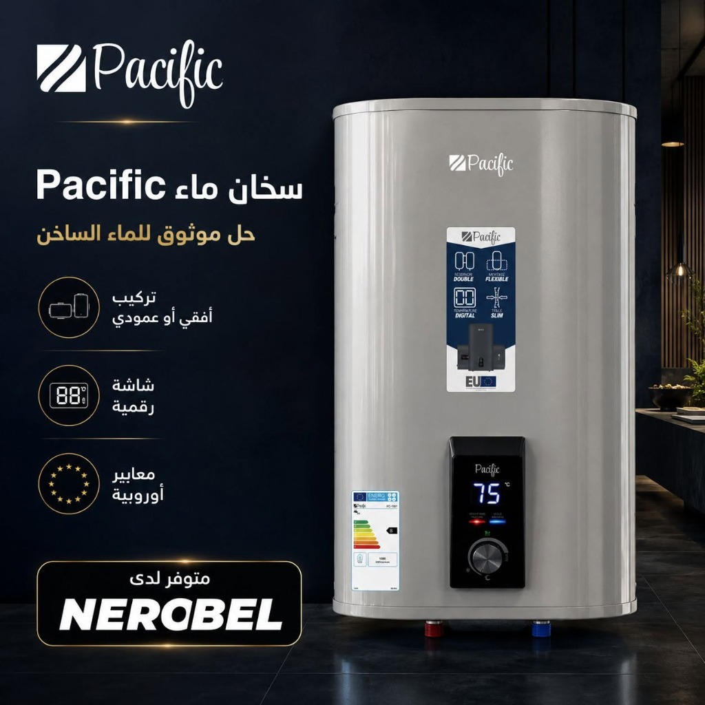
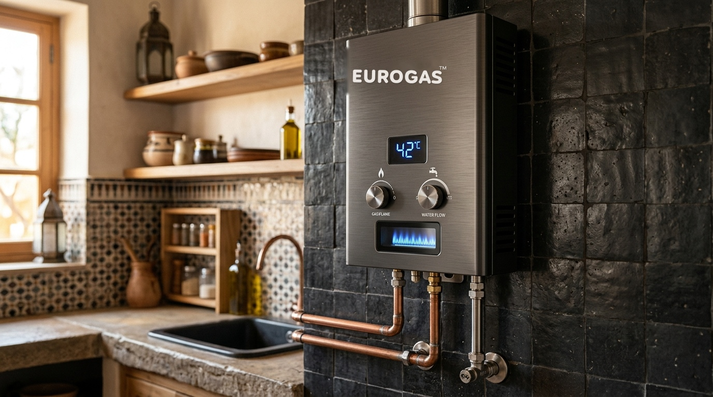
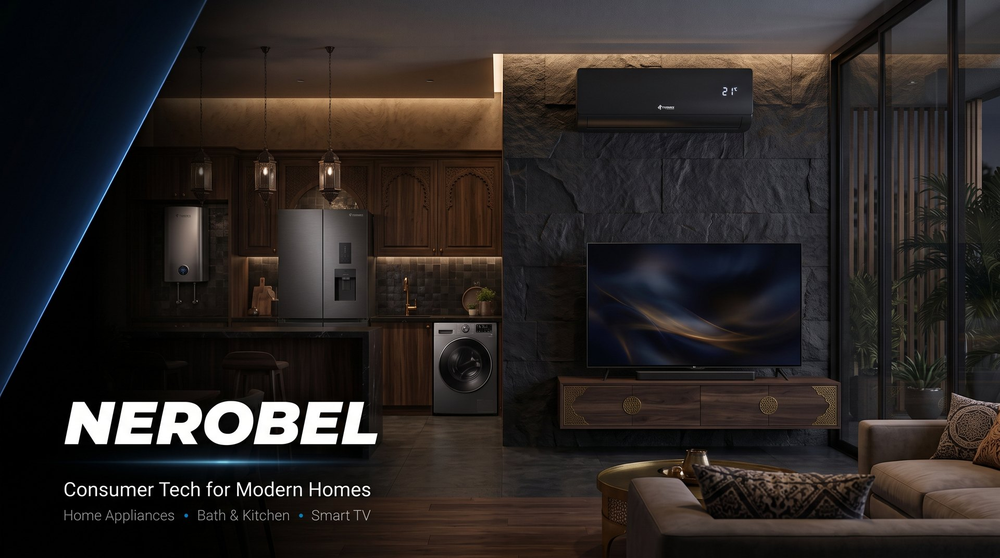
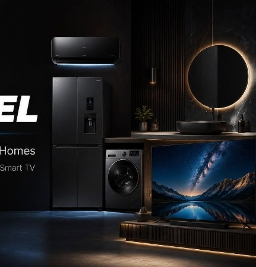

# De la Robinetterie Haut de Gamme à la Consumer Tech : Inspiration GROHE pour Nerobel Group

> **Document de Cadrage & Guide d'Implémentation UI/UX**  
> *Inspiré du composant Signature Collection Slider de GROHE (GROHE SPA)*  
> *Destiné à l'écosystème web : Nerobel Group (`index.html` & `brands.html`)*

---

## 1. Vision & Diagnostic Comparatif

Sur le site officiel [GROHE](https://www.grohe.com/) (section **GROHE SPA / Collections**), l'expérience utilisateur dépasse la simple présentation de catalogue produit. Elle installe un **univers architectural, sensoriel et statutaire** qui valorise les finitions métalliques, les textures et la pureté des lignes.

```
┌─────────────────────────────────────────────────────────────────────────────────────────────────┐
│ GROHE SPA                                                                            [ < ] [ > ]│
│ "Discover the progressive designs of GROHE SPA fused with carefully selected colours..."       │
├──────────────┬──────────────────┬──────────────────┬──────────────────┬─────────────────────────┤
│ [Macro Photo]│  [Macro Photo]   │  [Macro Photo]   │  [Macro Photo]   │  [Macro Photo]          │
│ Brushed Gold │  Chrome & Mirror │  Minimal Ceramic │  Rose Gold & Mar.│  Obsidian Black         │
├──────────────┼──────────────────┼──────────────────┼──────────────────┼─────────────────────────┤
│ GROHE Atrio  │  GROHE Allure    │  GROHE Airio     │  Atrio Private   │  GROHE Grandera         │
│ Icon of ...  │  Precision in... │  The new art...  │  For a person... │  Timeless arch...       │
└──────────────┴──────────────────┴──────────────────┴──────────────────┴─────────────────────────┘
  [ ══ ]─────────[ ── ]──────────────[ ── ]─────────────[ ── ]──────────────[ ── ] (Segmented Bar)
```

### Le Contexte Nerobel
Nerobel Group fédère des marques leaders au Maroc :
- **Theros** : Chauffe-eaux connectés Pro-Slim Wi-Fi, double réservoir titane, commande sur smartphone.
- **Pacific** : Chauffe-eaux universels multi-positions, acier vitrifié, durabilité éprouvée.
- **Eurogas** : Systèmes thermiques à gaz, sécurité ODS renforcée, certification CE.
- **Nerobel Consumer Tech** : Électroménager contemporain (réfrigérateurs multi-portes noir mat, climatisation Inverter, Smart TV OLED).

### L'Opportunité
Actuellement, la section marques de Nerobel présente une grille standard à 4 cartes fonctionnelles. L'intégration de la philosophie GROHE permettra de :
1. **Élever la perception de valeur** : Passer d'un distributeur d'équipements à une **maison de confort contemporain et d'ingénierie domestique**.
2. **Créer du dynamisme visuel** : Transformer la grille statique en un **carrousel fluide à ratio vertical (portrait)** avec macro-photographies de détails.
3. **Instaurer un rythme architectural** : Offrir une respiration éditoriale avec des typographies affirmées et un sélecteur horizontal segmenté.

---

## 2. Déconstruction des 6 Piliers de l'Expérience GROHE

| Pilier | Traitement GROHE | Transposition pour Nerobel |
| :--- | :--- | :--- |
| **1. Ambiance de Fond** | Fond chaud architectural (ton sable / travertin doux `#EBE7DF`) créant un contraste doux. | **Mode Clair** : Ton pierre calcaire / albâtre chaud (`#F5F4F0`).<br>**Mode Sombre** : Fond obsidienne profonde (`#050505`) avec halos subtils bleu électrique (`--az`). |
| **2. En-tête Éditorial & Commandes** | Paragraphe descriptif raffiné à gauche, boutons circulaires de défilement `<` `>` minimalistes à droite. | Accroche éditoriale sur le savoir-faire thermique et tech, flèches circulaires épurées positionnées en miroir. |
| **3. Anatomie des Cartes** | Format vertical élancé (ratio 3:4 ou 9:16), coins arrondis soignés (`border-radius: 18px`). | Cartes verticales élancées mettent en valeur la verticalité des chauffe-eaux Pro-Slim et la prestance des réfrigérateurs. |
| **4. Division Visuel / Conteneur** | **65% supérieur** : Photographie macro en gros plan.<br>**35% inférieur** : Bloc plein nuit sombre avec typographie contrastée. | **65% haut** : Focus textures (titane brossé, afficheur LED tactile, raccords laiton, noir mat sablé).<br>**35% bas** : Socle bleu nuit / onyx (`--s2`) avec nom de la collection et signature narrative. |
| **5. Typographie & Poétique** | Titre fort en sans-serif géométrique, suivi d'un sous-titre poétique et concis (ex. *"The new art of minimalism"*). | Nom de gamme en gras (`Montserrat` / `Cairo`), complété par une promesse d'usage évocatrice (ex. *"L'Élégance Connectée & Extra-Plate"*). |
| **6. Indicateur de Progression** | Barre de progression segmentée au bas du slider, synchronisée avec l'état de défilement actif. | Ligne de pagination segmentée interactive, réagissant au scroll, au swipe mobile et aux clics. |

---

## 3. Définition des Collections Signatures Nerobel

Pour nourrir ce composant inspiré de GROHE, nous structurons les gammes Nerobel en **5 Collections Signatures** :



### Détail des 5 Cartes de la Collection :

1. **Theros Pro-Slim Series**
   - *Visuel macro* : Gros plan en lumière rasante sur l'afficheur tactile noir onyx et le voyant Wi-Fi bleu pulsant, profil ultra-fin de 25 cm.
   - *Titre* : **Theros Pro-Slim**
   - *Sous-titre* : *L'Intelligence thermique connectée au degré près*
   - *Lien direct* : `brands.html#theros`

2. **Pacific Horizon**
   - *Visuel macro* : Raccordement haute précision, double cuve titane vitrifiée et sélecteur rotatif thermostatique à 75°C.
   - *Titre* : **Pacific Horizon**
   - *Sous-titre* : *La flexibilité multi-positions et la durabilité absolue*
   - *Lien direct* : `brands.html#pacific`

3. **Eurogas Master Force**
   - *Visuel macro* : Chambre de combustion cuivre protégée, veilleuse basse pression et détails de sécurité européenne CE.
   - *Titre* : **Eurogas Master Force**
   - *Sous-titre* : *La maîtrise instantanée de la puissance gaz*
   - *Lien direct* : `brands.html#eurogas`

4. **Nerobel Black Titanium**
   - *Visuel macro* : Texture d'acier inoxydable noir mat brossé sans traces, jointure invisible des portes françaises et rétroéclairage intérieur givré.
   - *Titre* : **Nerobel Black Titanium**
   - *Sous-titre* : *Le froid contemporain et la conservation intelligente*
   - *Lien direct* : `brands.html#nerobel-tech`

5. **Nerobel Vision OLED**
   - *Visuel macro* : Angle biseauté de 4 mm d'épaisseur, cadre en aluminium graphite et contraste absolu des noirs profonds.
   - *Titre* : **Nerobel Vision OLED**
   - *Sous-titre* : *L'art de l'immersion visuelle et de la finesse extrême*
   - *Lien direct* : `brands.html#nerobel-tech`

---

## 4. Spécifications UI/UX & Responsive Design

### Comportement du Slider selon la Résolution
- **Desktop Large (≥ 1280px)** : 4 cartes affichées simultanément + amorce visuelle (peek) de la 5ème carte pour inviter naturellement au défilement.
- **Laptop / Tablette Paysage (1024px - 1279px)** : 3 cartes pleines visibles.
- **Tablette Portrait (768px - 1023px)** : 2 cartes visibles + flèches de navigation actives.
- **Mobile (< 768px)** : 1 carte complète + 20% de la carte suivante visible (effet d'amorce tactile avec `scroll-snap-type: x mandatory`).

### Prise en Charge RTL (Arabe) & Trilingue (FR / AR / EN)
- En mode arabe (`dir="rtl"`), le sens de défilement naturel s'inverse.
- Les boutons fléchés `<` et `>` permutent logiquement leur fonction via la logique CSS Logical Properties (`margin-inline-start`, `inset-inline`).
- La typographie bascule fluidement vers la police **Cairo** pour conserver l'équilibre graphique et la lisibilité du titre.

---

## 5. Guide Technique & Code Prêt à l'Intégration

### A. Structure HTML Sémantique (`index.html` ou `brands.html`)

```html
<!-- ============================================================== -->
<!-- NEROBEL SIGNATURE COLLECTIONS (Inspiré de l'architecture GROHE)-->
<!-- ============================================================== -->
<section class="section collection-showcase" id="collections-signatures" aria-label="Collections Signatures Nerobel">
  <div class="container">
    
    <!-- En-tête avec présentation éditoriale et commandes de navigation -->
    <div class="collection-header">
      <div class="collection-intro">
        <div class="eyebrow eyebrow-gold">
          <i class="ti ti-crown"></i>
          <span data-i18n="collectionEyebrow">Design &amp; Ingénierie de Précision</span>
        </div>
        <h2 class="section-title" data-i18n="collectionTitle">
          Les Collections Signatures de l'Habitat Moderne
        </h2>
        <p class="collection-lead" data-i18n="collectionLead">
          Découvrez la fusion de l'ingénierie thermique d'avant-garde et de matériaux rigoureusement sélectionnés. Des solutions connectées Theros à l'électroménager noir mat Nerobel, chaque ligne est pensée pour sublimer les intérieurs contemporains.
        </p>
      </div>

      <!-- Commandes de navigation de type GROHE -->
      <div class="collection-controls" role="group" aria-label="Contrôles du carrousel">
        <button type="button" class="ctrl-btn ctrl-prev" id="collPrevBtn" aria-label="Collection précédente">
          <i class="ti ti-chevron-left"></i>
        </button>
        <button type="button" class="ctrl-btn ctrl-next" id="collNextBtn" aria-label="Collection suivante">
          <i class="ti ti-chevron-right"></i>
        </button>
      </div>
    </div>

    <!-- Piste de défilement (Track) -->
    <div class="collection-track-wrapper">
      <div class="collection-track" id="collectionTrack" tabindex="0" role="region" aria-roledescription="carousel">
        
        <!-- Carte 1 : Theros Pro-Slim -->
        <article class="collection-card" role="group" aria-roledescription="slide" aria-label="1 sur 5 : Theros Pro-Slim">
          <a href="brands.html#theros" class="collection-card-link">
            <div class="collection-visual-pane">
              
              <span class="collection-badge-tag"><i class="ti ti-wifi"></i> Wi-Fi Smart</span>
            </div>
            <div class="collection-info-pane">
              <div class="collection-brand-sub">THEROS · SMART THERMAL</div>
              <h3 class="collection-card-title">Theros Pro-Slim</h3>
              <p class="collection-card-desc">L'art du confort thermique ultra-plat piloté sur smartphone.</p>
              <span class="collection-card-action">
                <span>Découvrir la collection</span>
                <i class="ti ti-arrow-right"></i>
              </span>
            </div>
          </a>
        </article>

        <!-- Carte 2 : Pacific Horizon -->
        <article class="collection-card" role="group" aria-roledescription="slide" aria-label="2 sur 5 : Pacific Horizon">
          <a href="brands.html#pacific" class="collection-card-link">
            <div class="collection-visual-pane">
              
              <span class="collection-badge-tag"><i class="ti ti-arrows-maximize"></i> Multi-Position</span>
            </div>
            <div class="collection-info-pane">
              <div class="collection-brand-sub">PACIFIC · HAUTE RÉSISTANCE</div>
              <h3 class="collection-card-title">Pacific Horizon</h3>
              <p class="collection-card-desc">Double cuve vitrifiée et modularité d'installation horizontale ou verticale.</p>
              <span class="collection-card-action">
                <span>Découvrir la collection</span>
                <i class="ti ti-arrow-right"></i>
              </span>
            </div>
          </a>
        </article>

        <!-- Carte 3 : Eurogas Master -->
        <article class="collection-card" role="group" aria-roledescription="slide" aria-label="3 sur 5 : Eurogas Master">
          <a href="brands.html#eurogas" class="collection-card-link">
            <div class="collection-visual-pane">
              
              <span class="collection-badge-tag"><i class="ti ti-flame"></i> Sécurité ODS</span>
            </div>
            <div class="collection-info-pane">
              <div class="collection-brand-sub">EUROGAS™ · SÉCURITÉ GAZ</div>
              <h3 class="collection-card-title">Eurogas Master</h3>
              <p class="collection-card-desc">Chauffe instantanée, triple protection et conformité CE.</p>
              <span class="collection-card-action">
                <span>Découvrir la collection</span>
                <i class="ti ti-arrow-right"></i>
              </span>
            </div>
          </a>
        </article>

        <!-- Carte 4 : Nerobel Titanium -->
        <article class="collection-card" role="group" aria-roledescription="slide" aria-label="4 sur 5 : Nerobel Titanium">
          <a href="brands.html#nerobel-tech" class="collection-card-link">
            <div class="collection-visual-pane">
              
              <span class="collection-badge-tag"><i class="ti ti-snowflake"></i> Black Matte</span>
            </div>
            <div class="collection-info-pane">
              <div class="collection-brand-sub">NEROBEL · CONSUMER TECH</div>
              <h3 class="collection-card-title">Black Titanium</h3>
              <p class="collection-card-desc">Froid haute capacité multi-portes et compresseur Inverter silencieux.</p>
              <span class="collection-card-action">
                <span>Découvrir la collection</span>
                <i class="ti ti-arrow-right"></i>
              </span>
            </div>
          </a>
        </article>

        <!-- Carte 5 : Nerobel Vision OLED -->
        <article class="collection-card" role="group" aria-roledescription="slide" aria-label="5 sur 5 : Nerobel Vision OLED">
          <a href="brands.html#nerobel-tech" class="collection-card-link">
            <div class="collection-visual-pane">
              
              <span class="collection-badge-tag"><i class="ti ti-device-tv"></i> OLED 4K HDR</span>
            </div>
            <div class="collection-info-pane">
              <div class="collection-brand-sub">NEROBEL · ENTERTAINMENT</div>
              <h3 class="collection-card-title">Vision Bezel-Less</h3>
              <p class="collection-card-desc">Contraste infini, profil ultra-fin et son cinéma immersif.</p>
              <span class="collection-card-action">
                <span>Découvrir la collection</span>
                <i class="ti ti-arrow-right"></i>
              </span>
            </div>
          </a>
        </article>

      </div>
    </div>

    <!-- Barre de Progression Segmentée (Type GROHE) -->
    <div class="collection-progress-bar" id="collProgressBar" role="progressbar" aria-valuenow="1" aria-valuemin="1" aria-valuemax="5">
      <div class="progress-segment active" data-index="0"></div>
      <div class="progress-segment" data-index="1"></div>
      <div class="progress-segment" data-index="2"></div>
      <div class="progress-segment" data-index="3"></div>
      <div class="progress-segment" data-index="4"></div>
    </div>

  </div>
</section>
```

---

### B. Styles CSS Dédiés (`css/main.css` ou module `css/grohe-showcase.css`)

```css
/* ─────────────────────────────────────────────────────────────
   GROHE-INSPIRED COLLECTION SHOWCASE STYLES
   ───────────────────────────────────────────────────────────── */

.collection-showcase {
  position: relative;
  padding: 90px 0 80px;
  background-color: var(--s1);
  overflow: hidden;
  border-top: 1px solid var(--bd);
  border-bottom: 1px solid var(--bd);
}

/* Thème Clair : Adoption de l'ambiance calcaire / travertin GROHE */
[data-theme="light"] .collection-showcase {
  background-color: #F4F1EA; /* Teinte chaude façon GROHE SPA */
  border-color: #E2DDD3;
}

/* En-tête : Mise en page éditoriale */
.collection-header {
  display: flex;
  justify-content: space-between;
  align-items: flex-end;
  gap: 32px;
  margin-bottom: 40px;
}

.collection-intro {
  max-width: 720px;
}

.collection-lead {
  font-size: 1.05rem;
  line-height: 1.65;
  color: var(--tx2);
  margin-top: 14px;
}

/* Boutons de commande circulaires épurés (Style GROHE) */
.collection-controls {
  display: flex;
  gap: 12px;
}

.ctrl-btn {
  width: 48px;
  height: 48px;
  border-radius: 50%;
  border: 1.5px solid var(--bd);
  background: var(--s2);
  color: var(--tx);
  display: inline-flex;
  align-items: center;
  justify-content: center;
  font-size: 1.25rem;
  cursor: pointer;
  transition: all var(--trans);
}

[data-theme="light"] .ctrl-btn {
  background: #FFFFFF;
  border-color: #D3CDC2;
  color: #1A1A1E;
}

.ctrl-btn:hover {
  background: var(--az);
  border-color: var(--az);
  color: #FFFFFF;
  transform: translateY(-2px);
  box-shadow: 0 6px 18px var(--glow);
}

.ctrl-btn:disabled {
  opacity: 0.35;
  cursor: not-allowed;
  transform: none;
  box-shadow: none;
}

/* Piste de défilement (Track) avec Scroll Snap natif */
.collection-track-wrapper {
  position: relative;
  margin: 0 -16px;
  padding: 10px 16px 20px;
}

.collection-track {
  display: flex;
  gap: 24px;
  overflow-x: auto;
  scroll-behavior: smooth;
  scroll-snap-type: x mandatory;
  scrollbar-width: none; /* Firefox */
  -webkit-overflow-scrolling: touch;
}

.collection-track::-webkit-scrollbar {
  display: none; /* Chrome & Safari */
}

/* Cartes Collections au ratio portrait élancé */
.collection-card {
  flex: 0 0 calc(28% - 18px); /* 4 cartes visibles + peek sur desktop */
  min-width: 290px;
  max-width: 360px;
  scroll-snap-align: start;
  border-radius: var(--radius-lg);
  overflow: hidden;
  background: var(--s2);
  border: 1px solid var(--bd);
  box-shadow: var(--shadow-md);
  transition: transform var(--trans), border-color var(--trans), box-shadow var(--trans);
}

[data-theme="light"] .collection-card {
  background: #111625; /* Contraste fort inspiré de GROHE : cartes foncées sur fond beige chaud */
  border-color: rgba(255, 255, 255, 0.08);
  box-shadow: 0 16px 36px rgba(17, 22, 37, 0.15);
}

.collection-card:hover {
  transform: translateY(-8px);
  border-color: var(--az);
  box-shadow: var(--shadow-lg), 0 0 25px var(--glow);
}

.collection-card-link {
  display: flex;
  flex-direction: column;
  height: 100%;
  text-decoration: none;
  color: inherit;
}

/* Volet Visuel Supérieur (60-65% de la hauteur) */
.collection-visual-pane {
  position: relative;
  height: 320px;
  overflow: hidden;
  background-color: #000000;
}

.collection-img {
  width: 100%;
  height: 100%;
  object-fit: cover;
  object-position: center;
  transition: transform 0.6s var(--ease);
}

.collection-card:hover .collection-img {
  transform: scale(1.06);
}

.collection-badge-tag {
  position: absolute;
  top: 14px;
  left: 14px;
  background: rgba(12, 12, 14, 0.75);
  backdrop-filter: blur(8px);
  border: 1px solid rgba(255, 255, 255, 0.15);
  color: #FFFFFF;
  font-size: 0.75rem;
  font-weight: 600;
  padding: 4px 10px;
  border-radius: var(--radius-pill);
  display: inline-flex;
  align-items: center;
  gap: 5px;
}

/* Volet Textuel Inférieur (35-40% de la hauteur) */
.collection-info-pane {
  padding: 24px;
  display: flex;
  flex-direction: column;
  flex-grow: 1;
  background: var(--s2);
}

[data-theme="light"] .collection-info-pane {
  background: #111625;
}

.collection-brand-sub {
  font-family: var(--fm);
  font-size: 0.72rem;
  font-weight: 700;
  letter-spacing: 0.08em;
  color: var(--az);
  margin-bottom: 6px;
  text-transform: uppercase;
}

.collection-card-title {
  font-size: 1.25rem;
  font-weight: 700;
  color: #FFFFFF;
  margin-bottom: 8px;
}

.collection-card-desc {
  font-size: 0.88rem;
  line-height: 1.5;
  color: var(--tx2);
  margin-bottom: 18px;
  display: -webkit-box;
  -webkit-line-clamp: 2;
  -webkit-box-orient: vertical;
  overflow: hidden;
}

.collection-card-action {
  margin-top: auto;
  font-size: 0.82rem;
  font-weight: 600;
  color: var(--az);
  display: inline-flex;
  align-items: center;
  gap: 6px;
  transition: gap var(--trans);
}

.collection-card:hover .collection-card-action {
  gap: 10px;
  color: var(--azh);
}

/* Barre de progression segmentée GROHE */
.collection-progress-bar {
  display: flex;
  align-items: center;
  gap: 8px;
  margin-top: 36px;
  max-width: 280px;
}

.progress-segment {
  height: 3px;
  flex: 1;
  background: var(--bd);
  border-radius: 2px;
  cursor: pointer;
  transition: all var(--trans);
}

[data-theme="light"] .progress-segment {
  background: #D3CDC2;
}

.progress-segment.active {
  height: 4px;
  background: var(--az);
  box-shadow: 0 0 10px var(--glow);
}

/* Adaptation Responsive */
@media (max-width: 1024px) {
  .collection-card {
    flex: 0 0 calc(45% - 16px);
  }
}

@media (max-width: 768px) {
  .collection-header {
    flex-direction: column;
    align-items: flex-start;
  }
  
  .collection-controls {
    align-self: flex-end;
  }
  
  .collection-card {
    flex: 0 0 82%;
    min-width: 260px;
  }
  
  .collection-visual-pane {
    height: 260px;
  }
}

/* Support RTL (Arabe) */
[dir="rtl"] .collection-controls {
  flex-direction: row-reverse;
}

[dir="rtl"] .collection-card-action i {
  transform: rotate(180deg);
}

[dir="rtl"] .collection-brand-sub {
  letter-spacing: 0;
}
```

---

### C. Contrôleur JavaScript Léger (`js/collection-slider.js` ou intégré à `js/main.js`)

```javascript
/* ─────────────────────────────────────────────────────────────
   GROHE-STYLE COLLECTION CAROUSEL CONTROLLER
   ───────────────────────────────────────────────────────────── */
document.addEventListener('DOMContentLoaded', () => {
  const track = document.getElementById('collectionTrack');
  const prevBtn = document.getElementById('collPrevBtn');
  const nextBtn = document.getElementById('collNextBtn');
  const segments = document.querySelectorAll('.progress-segment');

  if (!track || !prevBtn || !nextBtn) return;

  const getScrollAmount = () => {
    const card = track.querySelector('.collection-card');
    if (!card) return 320;
    const gap = parseInt(window.getComputedStyle(track).gap) || 24;
    return card.offsetWidth + gap;
  };

  // Clic Défilement Précédent / Suivant
  prevBtn.addEventListener('click', () => {
    const isRtl = document.documentElement.dir === 'rtl';
    const amount = getScrollAmount();
    track.scrollBy({ left: isRtl ? amount : -amount, behavior: 'smooth' });
  });

  nextBtn.addEventListener('click', () => {
    const isRtl = document.documentElement.dir === 'rtl';
    const amount = getScrollAmount();
    track.scrollBy({ left: isRtl ? -amount : amount, behavior: 'smooth' });
  });

  // Mise à jour de la barre de progression segmentée
  const updateProgress = () => {
    const scrollLeft = Math.abs(track.scrollLeft);
    const maxScroll = track.scrollWidth - track.clientWidth;
    if (maxScroll <= 0) return;

    const progressRatio = scrollLeft / maxScroll;
    const activeIndex = Math.min(
      segments.length - 1,
      Math.round(progressRatio * (segments.length - 1))
    );

    segments.forEach((seg, idx) => {
      seg.classList.toggle('active', idx === activeIndex);
    });

    // Gestion de l'état désactivé des boutons
    const isRtl = document.documentElement.dir === 'rtl';
    if (!isRtl) {
      prevBtn.disabled = scrollLeft <= 4;
      nextBtn.disabled = scrollLeft >= maxScroll - 4;
    }
  };

  track.addEventListener('scroll', updateProgress, { passive: true });

  // Clic direct sur un segment de la barre
  segments.forEach((seg, idx) => {
    seg.addEventListener('click', () => {
      const maxScroll = track.scrollWidth - track.clientWidth;
      const targetScroll = (idx / (segments.length - 1)) * maxScroll;
      track.scrollTo({ left: targetScroll, behavior: 'smooth' });
    });
  });

  // Initialisation au chargement
  updateProgress();
});
```

---

## 6. Plan d'Implémentation & Emplacements dans Nerobel

### 1. Sur la page d'accueil (`index.html`)
- **Remplacement / Évolution** : Le nouveau composant remplace avantageusement la section statique `#marques` (`brands-grid-4`) tout en conservant les liens profonds vers les fiches détaillées.
- **Résultat** : L'accueil gagne en standing, le visiteur peut immédiatement faire défiler les univers produits phares sans surcharger la page d'accueil avec des colonnes interminables.

### 2. Sur la page Marques & Innovations (`brands.html`)
- **Insertion** : En guise de bannière interactive de sélection rapide, juste après le héros d'ouverture (`page-hero`).
- **Rôle** : Servir de "Table des Matières Visuelle" interactive. En cliquant sur une carte du slider, la page effectue un défilement doux (`scroll-into-view`) vers la section technique approfondie correspondante (Theros, Pacific, Eurogas, Nerobel Tech).

---

## 7. Recommandations Artistiques & Direction Visuelle (Asset Guidelines)

Pour égaler la qualité visuelle de GROHE :
1. **Éclairage & Prise de Vue** :
   - Prises de vue en studio avec éclairage latéral rasant (*chiaroscuro* doux) pour faire ressortir les chanfreins de l'acier brossé, les sérigraphies et les afficheurs numériques.
   - Éviter les rendus 3D plats ou non texturés ; privilégier des reflets réalistes sur les cuves et les verres trempés.
2. **Rapport d'Aspect des Images** :
   - Format source recommandé : **800 × 1000 px (ratio 4:5)** au format moderne `.webp` ou `.avif`.
   - Compression optimisée (< 120 Ko par image) avec balise `<picture>` et chargement différé (`loading="lazy"`).
3. **Harmonie Chromatique** :
   - Alterner les nuances chaudes (or/laiton Eurogas) et froides (titane/bleu Theros) pour susciter l'intérêt visuel tout au long du défilement.

---

*Document élaboré pour le projet Nerobel Group · Octobre 2026.*
