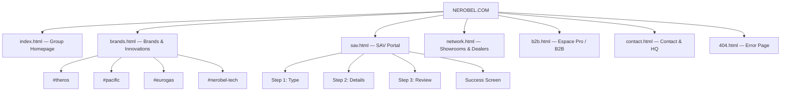

# NEROBEL GROUP — Production Implementation Blueprint

> **Document version:** 2.0 — October 2026
> **Purpose:** Complete, pixel-precise specification for rebuilding the Nerobel Group corporate website to best-in-class industrial luxury standards. Hand this file directly to any development team or AI coding agent.

---

## Table of Contents

1. [Executive Diagnosis of Current Version](#1-executive-diagnosis)
2. [Competitive Benchmarks & Inspiration](#2-benchmarks)
3. [Design System & Graphic Charter](#3-design-system)
4. [Site Architecture & Information Hierarchy](#4-architecture)
5. [Page-by-Page Specifications](#5-pages)
   - 5.1 Homepage (index.html)
   - 5.2 Brands & Innovations (brands.html)
   - 5.3 SAV Portal (sav.html)
   - 5.4 Network & Showrooms (network.html)
   - 5.5 B2B / Espace Pro (b2b.html)
   - 5.6 Contact (contact.html)
6. [Shared Components Library](#6-components)
7. [Animation & Micro-Interaction Spec](#7-animations)
8. [Internationalization (i18n) Architecture](#8-i18n)
9. [Responsive Breakpoint Strategy](#9-responsive)
10. [Accessibility (WCAG 2.1 AA)](#10-accessibility)
11. [Performance & SEO Checklist](#11-performance)
12. [Asset Pipeline & File Structure](#12-assets)
13. [Deployment & Quality Assurance](#13-deployment)

---

## 1. Executive Diagnosis of Current Version <a id="1-executive-diagnosis"></a>

### 1.1 What Works Well ✅

| Aspect | Assessment |
|--------|-----------|
| **Design Token System** | `css/theme.css` provides a solid CSS custom properties foundation with dark/light themes, brand colors (`--az: #3AA0E6`, `--gold: #C9A96A`), and typography stacks |
| **Header Uniformity** | All 6 pages share identical header DOM (logo, nav, lang switcher, theme toggle, CTA), ensuring brand consistency |
| **Footer Standardization** | Full 4-column corporate footer with brand links, services, group info, and legal bar is consistent across every page |
| **SAV Portal** | Well-structured 3-step wizard with GPS capture, webcam photo, serial number guide modal — functionally complete |
| **i18n Framework** | `data-i18n` attribute system with `js/i18n.js` supports FR/AR/EN including RTL direction switching |
| **Form Architecture** | SAV and B2B forms use consistent `.form-group`, `.form-label`, `.form-input` pattern |

### 1.2 Critical Issues to Fix 🔴

| # | Issue | Impact | Where |
|---|-------|--------|-------|
| **D1** | **Excessive inline styles** — Over 200 `style="..."` attributes across HTML files for layout, padding, colors, font sizes. This defeats the purpose of the design system and makes maintenance nightmarish | High | All pages |
| **D2** | **Inconsistent section spacing** — Hero padding varies (56px on page-hero, 60px on homepage), section padding differs (`padding-top:48px` vs `60px` vs `40px`) with no rhythm | Medium | All inner pages |
| **D3** | **No scroll-driven animations** — Static content loads without entrance animations. Best-in-class sites (Grohe, Viessmann, Bosch) use IntersectionObserver-based reveal animations | High | All pages |
| **D4** | **Homepage hero is content-heavy** — Long paragraph text, trust badges, WhatsApp number, and dual CTAs create cognitive overload at first glance. Premium sites lead with visual impact, not text walls | High | index.html |
| **D5** | **Brand cards have inline style overrides** — `.brand-card-img-wrap` and `.brand-card-body` heights/paddings are overridden inline, breaking responsive consistency | Medium | index.html |
| **D6** | **Network page nesting error** — Double `.container` nesting at lines 119-135 | Low | network.html |
| **D7** | **No "About/Group" narrative section** — The homepage lacks a compelling "Who is Nerobel?" story block. Competitors like Grohe and Viessmann tell their heritage story on the landing page | High | index.html |
| **D8** | **B2B page is too minimal** — Only 3 perk cards and a form. No trust signals, no partner logos, no case studies | Medium | b2b.html |
| **D9** | **Contact page layout** — Single-column stacking, missing Google Maps embed, no visual hierarchy between address card and contact form | Medium | contact.html |
| **D10** | **No favicon or Open Graph meta** — Missing `<link rel="icon">`, no `og:image`, `og:title`, `twitter:card` tags for social sharing | Medium | All pages |
| **D11** | **No loading/skeleton states** — Forms and map areas have no loading feedback | Low | sav.html, network.html |
| **D12** | **Missing `<main>` landmark label** — Screen readers cannot differentiate main content | Low | All pages |
| **D13** | **No 404 page** — Missing error page | Low | — |
| **D14** | **Brands page product sections use inline grid** — `style="display:grid; grid-template-columns:1fr; gap:48px;"` should be a reusable CSS class | Medium | brands.html |

### 1.3 Performance Audit

| Metric | Current | Target |
|--------|---------|--------|
| Total page weight (index) | ~1.8 MB (unoptimized JPGs) | < 800 KB |
| CSS files loaded | 2-3 per page | Merge to 1 critical + 1 page-specific |
| JS files loaded | 3-5 per page (including Leaflet) | Defer non-critical, lazy-load map |
| Image format | JPG (no WebP) | WebP with JPG fallback |
| Font files | 4 families via Google Fonts | Preload primary (Montserrat + Inter), defer others |

---

## 2. Competitive Benchmarks & Inspiration <a id="2-benchmarks"></a>

### 2.1 Reference Models

| Brand | URL | What to Extract |
|-------|-----|-----------------|
| **Grohe** | grohe.com | Lifestyle-meets-industrial luxury. Cinematic hero with product in context. Smooth scroll reveal. Clean product category navigation. Professional installer portal |
| **Viessmann** | viessmann.com | Climate solutions configurator. Interactive "Find your system" tool. Dual B2B/B2C entry gate. Trust metrics strip |
| **Bosch Home** | bosch-home.com | Modular design system. Mega-menu with visual categories. Product comparison tools. After-sales service portal |
| **Vaillant** | vaillant.com | Heat pump configurator. Regional dealer locator with map. Professional resources hub |
| **Sub-Zero/Wolf** | subzero-wolf.com | Dark luxury aesthetic. Full-bleed hero imagery. Architectural product photography. Clean navigation |

### 2.2 Key Patterns to Implement

```
PATTERN 1: CINEMATIC HERO (Homepage)
───────────────────────────────────────
• Full-viewport hero with subtle parallax
• Minimal text: 1 headline + 1 sub-line + 1 CTA
• Product image emerges from dark gradient
• Scroll indicator (animated chevron at bottom)
• Video background option (muted loop)

PATTERN 2: BRAND PORTFOLIO CAROUSEL
───────────────────────────────────────
• Horizontal scrollable brand universe cards
• Each card: full-width image + brand logo overlay
• Hover → reveal tagline + CTA link
• Keyboard and touch-swipe accessible

PATTERN 3: TRUST METRICS ANIMATED COUNTER
───────────────────────────────────────
• Numbers count up on scroll intersection
• Staggered reveal (200ms delay per metric)
• Icon + number + label format

PATTERN 4: SPLIT-SCREEN BRAND DEEP DIVE
───────────────────────────────────────
• Image left / Content right (alternating)
• Image has reveal animation (clipPath from left)
• Content staggers in: badge → title → text → CTA

PATTERN 5: INTERACTIVE DEALER MAP
───────────────────────────────────────
• Dark-themed Leaflet map with custom markers
• Sidebar list synced with map hover/click
• Filter by city + brand + service type
• Cards with address, phone, WhatsApp link, directions
```

---

## 3. Design System & Graphic Charter <a id="3-design-system"></a>

### 3.1 Color Palette

#### Dark Theme (Default — "Midnight Luxury")
```css
:root {
  /* Surfaces — Layered depth progression */
  --black:        #050505;      /* Deepest background */
  --bg-gradient:  radial-gradient(circle at 50% 0%, rgba(58,160,230,0.08) 0%, transparent 50%), #050505;
  --s1:           #0C0C0E;      /* Card / elevated surface */
  --s2:           #141417;      /* Input / nested card */
  --s3:           #1C1C21;      /* Active / hover surface */
  --s-glass:      rgba(12,12,14,0.75);  /* Glassmorphism */
  --header-bg:    rgba(5,5,5,0.88);     /* Sticky header blur */

  /* Borders — Subtle structure */
  --bd:           #2A2A31;      /* Default border */
  --bdh:          #3A3A44;      /* Hover border */
  --bd-glow:      rgba(58,160,230,0.45); /* Focus/active glow border */

  /* Typography */
  --tx:           #FFFFFF;      /* Primary text */
  --tx2:          #B4B8C0;      /* Secondary text */
  --tx3:          #8A8F99;      /* Tertiary / caption */

  /* Signature Saphir Impérial */
  --az:           #2563EB;      /* Primary accent */
  --azh:          #3B82F6;      /* Hover state */
  --azp:          #1D4ED8;      /* Pressed / gradient end */
  --glow:         rgba(37,99,235,0.18); /* Subtle glow */
  --glow-strong:  rgba(37,99,235,0.35); /* Strong glow */

  /* Prestige Gold */
  --gold:         #C9A96A;
  --gold-glow:    rgba(201,169,106,0.22);

  /* Semantic States */
  --ok:           #34C77B;      /* Success */
  --ok-bg:        rgba(52,199,123,0.12);
  --warn:         #F2B84B;      /* Warning */
  --err:          #FF5C6C;      /* Error */
  --err-bg:       rgba(255,92,108,0.12);
  --wa:           #25D366;      /* WhatsApp green */
}
```

#### Light Theme ("Architectural White")
```css
[data-theme="light"] {
  --black:        #F8FAFC;
  --s1:           #FFFFFF;
  --s2:           #F1F5F9;
  --s3:           #E2E8F0;
  --header-bg:    rgba(255,255,255,0.92);
  --bd:           #E2E8F0;
  --bdh:          #CBD5E1;
  --tx:           #0F172A;
  --tx2:          #475569;
  --tx3:          #64748B;
  --az:           #1D4ED8;
  --azh:          #1E40AF;
  --azp:          #172554;
}
```

### 3.2 Typography Scale

| Token | Family | Weight | Usage |
|-------|--------|--------|-------|
| `--fd` | **Montserrat** | 600-800 | Display headings, hero titles, brand names |
| `--fb` | **Inter** | 400-700 | Body text, UI labels, navigation, buttons |
| `--fm` | **JetBrains Mono** | 500-700 | Eyebrow badges, ticket codes, technical values |
| `--fa` | **Cairo** | 400-700 | Arabic RTL text override |

#### Heading Hierarchy

```
h1 (Hero/Page Title):  clamp(2rem, 4vw, 3rem)       | Montserrat 700 | line-height: 1.15
h2 (Section Title):    clamp(1.6rem, 3.2vw, 2.2rem)  | Montserrat 700 | line-height: 1.25
h3 (Card Title):       clamp(1.15rem, 2vw, 1.45rem)  | Montserrat 700 | line-height: 1.3
h4 (Sub-section):      1.05rem                        | Montserrat 700 | line-height: 1.35
Body text:             0.95rem                        | Inter 400      | line-height: 1.6
Caption/Small:         0.82-0.88rem                   | Inter 500      | line-height: 1.45
```

### 3.3 Spacing Rhythm

Use an **8px base grid** system:

```
--space-xs:   4px    (micro gaps)
--space-sm:   8px    (tight)
--space-md:   16px   (default)
--space-lg:   24px   (comfortable)
--space-xl:   32px   (section breathing)
--space-2xl:  48px   (major breaks)
--space-3xl:  64px   (section padding)
--space-4xl:  96px   (hero sections)
--space-5xl:  128px  (page-level gap)
```

### 3.4 Border Radius Tokens

```
--radius-sm:   8px     (inputs, small buttons)
--radius-md:   14px    (cards, modals)
--radius-lg:   20px    (hero stage, large cards)
--radius-pill:  9999px (pills, badges, CTAs)
```

### 3.5 Shadow Elevation System

```
--shadow-sm:    0 4px 12px rgba(0,0,0,0.5)           /* Cards */
--shadow-md:    0 12px 32px rgba(0,0,0,0.7)           /* Elevated cards */
--shadow-lg:    0 20px 50px rgba(0,0,0,0.9)           /* Modals, hero stage */
--shadow-glow:  0 0 25px rgba(58,160,230,0.25)        /* Blue accent glow */
```

### 3.6 Logo Specifications

| Context | Height | Max-Width | Filter (Light Mode) |
|---------|--------|-----------|---------------------|
| Header (desktop) | `32px` | `200px` | `filter: invert(1)` |
| Header (mobile) | `28px` | `170px` | `filter: invert(1)` |
| Mobile Drawer | `32px` | auto | `filter: invert(1)` |
| Footer | `32px` | auto | `filter: invert(1)` |

> **Critical:** Logo must NEVER have inline `height` or `style` attributes in HTML. All sizing is controlled exclusively by CSS classes.

---

## 4. Site Architecture & Information Hierarchy <a id="4-architecture"></a>

### 4.1 Sitemap



### 4.2 Primary Navigation Structure

```
┌─────────────────────────────────────────────────────────────────┐
│  LOGO    Groupe | Marques | Support SAV | Réseau | Pro | Contact│
│                                                                   │
│  [FR|ar|EN]  [☀/🌙]  [ 🔧 Demande SAV ]  [☰ Mobile]            │
└─────────────────────────────────────────────────────────────────┘
```

### 4.3 User Flow Paths

```
┌─ CONSUMER PATH ──────────────────────────────────────┐
│  Homepage → Brand Cards → Brand Detail → SAV Portal  │
│  Homepage → Quick Tracker → Ticket Status             │
│  Homepage → Network Map → Nearest Showroom            │
└──────────────────────────────────────────────────────┘

┌─ PROFESSIONAL PATH ──────────────────────────────────┐
│  Homepage → B2B Gateway → Partner Application Form   │
│  Homepage → Brand Catalog → Technical Specs Download │
│  Homepage → Contact → Commercial Inquiry             │
└──────────────────────────────────────────────────────┘

┌─ SAV PATH ───────────────────────────────────────────┐
│  Any Page → Header CTA → SAV Portal (Step 1)        │
│  Homepage → Quick Tracker → Enter Ticket Code        │
│  SAV Portal → Step 1→2→3 → Success → WhatsApp       │
└──────────────────────────────────────────────────────┘
```

---

## 5. Page-by-Page Specifications <a id="5-pages"></a>

---

### 5.1 Homepage — `index.html`

#### 5.1.1 Section Flow (Top to Bottom)

```
┌─ STICKY HEADER ──────────────────────────────────────────────────┐
│  (84px height · Glassmorphism blur · Scrolled shadow state)      │
├──────────────────────────────────────────────────────────────────┤
│                                                                    │
│  ┌─ HERO SECTION (100vh - header) ─────────────────────────────┐ │
│  │                                                               │ │
│  │  ┌─ LEFT (55%) ────────────────────────────────────────┐     │ │
│  │  │  [Eyebrow Badge] "Consumer Tech for Modern Homes"   │     │ │
│  │  │                                                       │     │ │
│  │  │  L'Excellence du Confort &                            │     │ │
│  │  │  de la **Maison Moderne**                             │     │ │
│  │  │                                                       │     │ │
│  │  │  Short 1-line descriptor (max 120 chars)              │     │ │
│  │  │                                                       │     │ │
│  │  │  [ Explorer nos Marques → ]  [ Portail SAV ]          │     │ │
│  │  └───────────────────────────────────────────────────────┘     │ │
│  │                                                               │ │
│  │  ┌─ RIGHT (45%) ──────────────────────────────────────┐      │ │
│  │  │  Product showcase image in rounded card with         │      │ │
│  │  │  gradient overlay + floating tag                     │      │ │
│  │  └────────────────────────────────────────────────────┘      │ │
│  │                                                               │ │
│  │  ↓ Scroll indicator (animated bouncing chevron)               │ │
│  └───────────────────────────────────────────────────────────────┘ │
│                                                                    │
│  ┌─ METRICS STRIP ─────────────────────────────────────────────┐ │
│  │  25+ Ans  |  150+ Showrooms  |  100% Garantie  |  24/48h    │ │
│  │  (animate count on scroll intersection)                       │ │
│  └───────────────────────────────────────────────────────────────┘ │
│                                                                    │
│  ┌─ GROUP STORY SECTION ── NEW ────────────────────────────────┐ │
│  │  "Qui est Nerobel ?"                                          │ │
│  │  Split layout: Image left (HQ photo) / Text right             │ │
│  │  3 short bullet points about the group heritage                │ │
│  │  Trust badges row (ISO, CE, Normes Marocaines)                │ │
│  └───────────────────────────────────────────────────────────────┘ │
│                                                                    │
│  ┌─ 3 GATEWAY PILLARS ────────────────────────────────────────┐  │
│  │  [Marques & Équipements]  [Support SAV]  [Espace Pro B2B]  │  │
│  │  Each: Icon → Title → 1-line desc → Link arrow              │  │
│  └───────────────────────────────────────────────────────────────┘ │
│                                                                    │
│  ┌─ BRAND SHOWCASE (4 Universe Cards) ─────────────────────────┐ │
│  │  Section Header: "Des Marques Leaders" with gold eyebrow     │ │
│  │  4-column grid: Theros | Pacific | Eurogas | Nerobel Tech    │ │
│  │  Each card: Image + Badge + Title + Lead + Nerobel Seal      │ │
│  └───────────────────────────────────────────────────────────────┘ │
│                                                                    │
│  ┌─ SAV TICKET TRACKER BAR ────────────────────────────────────┐ │
│  │  Left: Title + description                                    │ │
│  │  Right: Input field + Check button + New ticket link          │ │
│  └───────────────────────────────────────────────────────────────┘ │
│                                                                    │
│  ┌─ NETWORK TEASER STRIP ─────────────────────────────────────┐  │
│  │  "Un Réseau de Proximité" + CTA buttons                      │  │
│  └───────────────────────────────────────────────────────────────┘ │
│                                                                    │
├─ CORPORATE FOOTER ───────────────────────────────────────────────┤
│  4-col grid: Brand + Nos Marques + Services + Le Groupe          │
│  Blue laser line divider at top                                   │
│  Copyright + Legal links                                          │
└──────────────────────────────────────────────────────────────────┘
```

#### 5.1.2 Hero Section — Detailed Spec

```css
/* HERO — IMPLEMENTATION NOTES */
.hero-section {
  position: relative;
  min-height: calc(100vh - 84px);  /* Full viewport minus header */
  display: flex;
  align-items: center;
  padding: 80px 0 60px;
  overflow: hidden;
}
```

**Content Rules:**
- **Headline:** Max 8 words. Use `clamp(2rem, 4vw, 3rem)` font size
- **Sub-headline:** Max 120 characters. `1.05rem`, `--tx2` color
- **CTAs:** Max 2 buttons. Primary (blue fill) + Secondary (outline)
- **Remove:** Trust badges row from hero. Move to dedicated section below
- **Remove:** WhatsApp number from hero. It belongs in header CTA and footer
- **Hero image:** Use `object-fit: cover` inside rounded card with `box-shadow: var(--shadow-lg)`

**NEW — Scroll Indicator:**
```html
<div class="hero-scroll-indicator">
  <span>Défiler</span>
  <i class="ti ti-chevron-down"></i>
</div>
```
```css
.hero-scroll-indicator {
  position: absolute;
  bottom: 32px;
  left: 50%;
  transform: translateX(-50%);
  display: flex;
  flex-direction: column;
  align-items: center;
  gap: 6px;
  font-size: 0.78rem;
  color: var(--tx3);
  animation: heroScroll 1.5s ease-in-out infinite;
}

@keyframes heroScroll {
  0%, 100% { transform: translateX(-50%) translateY(0); opacity: 0.6; }
  50% { transform: translateX(-50%) translateY(8px); opacity: 1; }
}
```

#### 5.1.3 NEW — Group Story Section

```html
<section class="section section--story" id="about">
  <div class="container">
    <div class="story-grid">
      <div class="story-image-wrap">
        
      </div>
      <div class="story-content">
        <div class="eyebrow eyebrow-gold">
          <i class="ti ti-building"></i> Le Groupe Nerobel
        </div>
        <h2 class="section-title">
          25 Ans d'Expertise au Service du Confort Marocain
        </h2>
        <p class="section-desc">
          Fondé en 2001, Nerobel Group est devenu le leader national
          de l'équipement domestique moderne...
        </p>
        <ul class="story-highlights">
          <li><i class="ti ti-check"></i> Fabrication & distribution nationale</li>
          <li><i class="ti ti-check"></i> Standards CE & conformité européenne</li>
          <li><i class="ti ti-check"></i> Réseau de 150+ points de vente agréés</li>
        </ul>
        <a href="contact.html" class="btn btn-outline-blue">
          <span>En savoir plus</span>
          <i class="ti ti-arrow-right"></i>
        </a>
      </div>
    </div>
  </div>
</section>
```

```css
.story-grid {
  display: grid;
  grid-template-columns: 1fr;
  gap: 48px;
  align-items: center;
}

@media (min-width: 1024px) {
  .story-grid {
    grid-template-columns: 1fr 1fr;
  }
}

.story-image-wrap {
  position: relative;
  border-radius: var(--radius-lg);
  overflow: hidden;
  border: 1px solid var(--bd);
  box-shadow: var(--shadow-md);
}

.story-image {
  width: 100%;
  height: auto;
  display: block;
  transition: transform 0.6s var(--ease);
}

.story-image-wrap:hover .story-image {
  transform: scale(1.03);
}

.story-highlights {
  list-style: none;
  display: grid;
  gap: 12px;
  margin: 24px 0;
}

.story-highlights li {
  display: flex;
  align-items: center;
  gap: 10px;
  font-size: 0.92rem;
  color: var(--tx);
}

.story-highlights li i {
  color: var(--ok);
  font-size: 1.1rem;
}
```

---

### 5.2 Brands & Innovations — `brands.html`

#### 5.2.1 Section Flow

```
┌─ HEADER ─────────────────────────────────────────────────────────┐
├─ PAGE HERO ──────────────────────────────────────────────────────┤
│  Eyebrow: "Portefeuille Multi-Marques"                           │
│  H1: "L'Alliance des Marques Leaders au Maroc"                  │
│  Subtitle: 1-line descriptor                                     │
├──────────────────────────────────────────────────────────────────┤
│                                                                    │
│  ┌─ BRAND 1: THEROS (Image Left | Content Right) ─────────────┐ │
│  │  Brand logo badge → H2 → Description → Feature grid 2x1     │ │
│  │  → Nerobel seal → CTA buttons                                │ │
│  │  Right: Full product image in rounded container               │ │
│  └───────────────────────────────────────────────────────────────┘ │
│                                                                    │
│  ┌─ BRAND 2: PACIFIC (Content Left | Image Right) — alternate ─┐│
│  │  Same structure, reversed layout                              ││
│  └───────────────────────────────────────────────────────────────┘│
│                                                                    │
│  ┌─ BRAND 3: EUROGAS (Image Left | Content Right) ─────────────┐│
│  └───────────────────────────────────────────────────────────────┘│
│                                                                    │
│  ┌─ NEROBEL CONSUMER TECH (Full-width showcase) ───────────────┐│
│  │  Centered logo → Description → Full-width banner image        ││
│  └───────────────────────────────────────────────────────────────┘│
│                                                                    │
├─ FOOTER ─────────────────────────────────────────────────────────┤
```

#### 5.2.2 Brand Detail Grid — CSS Class (Replace Inline Styles)

```css
/* Brand Detail Section — Alternating Layout */
.brand-detail-grid {
  display: grid;
  grid-template-columns: 1fr;
  gap: 48px;
  align-items: center;
}

@media (min-width: 1024px) {
  .brand-detail-grid {
    grid-template-columns: 1fr 1fr;
  }
}

/* Reversed layout for alternating sections */
.brand-detail-grid--reversed .brand-detail-content {
  order: 2;
}
.brand-detail-grid--reversed .brand-detail-media {
  order: 1;
}

/* Feature mini-cards */
.brand-features-mini {
  display: grid;
  grid-template-columns: 1fr 1fr;
  gap: 16px;
  margin-bottom: 24px;
}

.brand-feature-card {
  background: var(--s2);
  border: 1px solid var(--bd);
  padding: 16px;
  border-radius: var(--radius-md);
  transition: border-color var(--trans);
}

.brand-feature-card:hover {
  border-color: var(--bdh);
}

.brand-feature-icon {
  font-size: 1.4rem;
  margin-bottom: 8px;
}

.brand-feature-title {
  font-weight: 700;
  color: var(--tx);
  font-size: 0.92rem;
  margin-bottom: 4px;
}

.brand-feature-desc {
  font-size: 0.85rem;
  color: var(--tx3);
  line-height: 1.45;
}

/* Product image frame */
.brand-detail-media {
  position: relative;
  border-radius: var(--radius-lg);
  overflow: hidden;
  border: 1px solid var(--bd);
  box-shadow: var(--shadow-lg);
}

.brand-detail-media img {
  width: 100%;
  height: auto;
  display: block;
  transition: transform 0.6s var(--ease);
}

.brand-detail-media:hover img {
  transform: scale(1.04);
}
```

---

### 5.3 SAV Portal — `sav.html`

#### 5.3.1 Architecture Overview

The SAV portal is the most complex page. It uses a **2-column layout** with a sticky sidebar and a 3-step wizard form.

```
┌─ HEADER ─────────────────────────────────────────────────────────┐
├─ PAGE HERO (Unified .page-hero) ─────────────────────────────────┤
├──────────────────────────────────────────────────────────────────┤
│  ┌─ SAV WRAPPER (max-width: 1280px) ───────────────────────────┐│
│  │                                                               ││
│  │  ┌─ SIDEBAR (4fr) ──────────┐  ┌─ MAIN FORM (7fr) ────────┐││
│  │  │  Sticky at top: 104px     │  │  Stepper progress bars     │││
│  │  │  Eyebrow + Title          │  │  Step indicator text        │││
│  │  │  Lead paragraph           │  │                             │││
│  │  │  3 Perk items:            │  │  STEP 1: Type Selection    │││
│  │  │  • 24-48h intervention    │  │  4 type cards (grid)       │││
│  │  │  • Original parts         │  │  Continue button            │││
│  │  │  • WhatsApp tracking      │  │                             │││
│  │  │  Warranty badge           │  │  STEP 2: Details & Form    │││
│  │  │                           │  │  Contact section            │││
│  │  │                           │  │  Equipment section          │││
│  │  │                           │  │  Photos dropzone            │││
│  │  │                           │  │  Back / Continue buttons    │││
│  │  │                           │  │                             │││
│  │  │                           │  │  STEP 3: Review & Submit   │││
│  │  │                           │  │  Data summary card          │││
│  │  │                           │  │  Back / Submit buttons      │││
│  │  │                           │  │                             │││
│  │  │                           │  │  SUCCESS PANEL              │││
│  │  │                           │  │  Check badge → Ticket code  │││
│  │  │                           │  │  WhatsApp + PDF + Reset     │││
│  │  └───────────────────────────┘  └─────────────────────────────┘││
│  └───────────────────────────────────────────────────────────────┘│
├─ MODALS: Serial Guide | GPS Map | Webcam ────────────────────────┤
├─ FOOTER ─────────────────────────────────────────────────────────┤
```

#### 5.3.2 Form Fields Specification

**Step 2 — Complete Field Map:**

| Field | ID | Type | Required | Validation | Options |
|-------|-----|------|----------|------------|---------|
| Nom et Prénom | `savFullName` | text | ✅ | Min 3 chars | — |
| Téléphone | `savPhone` | tel | ✅ | Moroccan format `/^0[5-7][0-9]{8}$/` | 🇲🇦 +212 prefix |
| Ville | `savCity` | select | ✅ | — | Casablanca, Rabat, Marrakech, Tanger, Fès, Meknès, Agadir, Oujda, Tétouan, Kénitra, Autre |
| Adresse | `savAddress` | text | ❌ | — | — |
| GPS Position | `btnGpsTrigger` | button | ❌ | Geolocation API | Opens Leaflet map modal |
| Marque | `savBrand` | select | ✅ | — | Theros, Pacific, Eurogas, Nerobel |
| N° de Série | `savSerial` | text | ✅ | Min 6 chars | Has "Aide" guide button |
| Type de Panne | `savProblem` | select | ✅ | — | 6 predefined options |
| Description | `savDescription` | textarea | ❌ | — | Placeholder guidance |
| Photos | `fileInput` | file | ❌ | JPG/PNG/PDF, max 10 MB | Dropzone + webcam capture |

#### 5.3.3 Stepper Logic (js/sav.js)

```javascript
// Step navigation state machine
const SAV_STATE = {
  currentStep: 1,
  selectedType: 'electric',
  formData: {},
  gpsCoords: null,
  attachedFile: null
};

// Validation rules per step
const STEP_VALIDATORS = {
  1: () => !!SAV_STATE.selectedType,
  2: () => {
    const name = document.getElementById('savFullName').value.trim();
    const phone = document.getElementById('savPhone').value.trim();
    const serial = document.getElementById('savSerial').value.trim();
    return name.length >= 3 &&
           /^0[5-7][0-9]{8}$/.test(phone) &&
           serial.length >= 6;
  },
  3: () => true  // Review step — always valid
};
```

---

### 5.4 Network & Showrooms — `network.html`

#### 5.4.1 Section Flow

```
┌─ HEADER ─────────────────────────────────────────────────────────┐
├─ PAGE HERO ──────────────────────────────────────────────────────┤
├──────────────────────────────────────────────────────────────────┤
│  ┌─ FILTERS BAR (centered pill) ───────────────────────────────┐│
│  │  Ville: [Select]    Marque: [Select]                          ││
│  └───────────────────────────────────────────────────────────────┘│
│                                                                    │
│  ┌─ MAP + DIRECTORY GRID ──────────────────────────────────────┐ │
│  │  ┌─ MAP (480px height) ──────────────────────────────────┐   │ │
│  │  │  Leaflet map with dark tiles + custom blue markers     │   │ │
│  │  │  Popup on click: Name, Address, Phone, WhatsApp        │   │ │
│  │  └────────────────────────────────────────────────────────┘   │ │
│  │                                                               │ │
│  │  ┌─ SHOWROOM CARDS GRID ────────────────────────────────┐    │ │
│  │  │  Auto-fit grid (min 300px per card)                    │    │ │
│  │  │  Each card: Name, City, Address, Phone, WhatsApp link  │    │ │
│  │  └────────────────────────────────────────────────────────┘    │ │
│  └───────────────────────────────────────────────────────────────┘ │
│                                                                    │
├─ FOOTER ─────────────────────────────────────────────────────────┤
```

#### 5.4.2 Map Configuration

```javascript
// Dark Leaflet tile theme
const MAP_CONFIG = {
  center: [31.7917, -7.0926],  // Morocco center
  zoom: 6,
  tileUrl: 'https://{s}.basemaps.cartocdn.com/dark_all/{z}/{x}/{y}{r}.png',
  tileAttribution: '© OpenStreetMap © CARTO',
  markerIcon: {
    iconUrl: 'assets/icons/map-pin-blue.svg',
    iconSize: [32, 42],
    iconAnchor: [16, 42],
    popupAnchor: [0, -42]
  }
};
```

#### 5.4.3 Showroom Card Component

```css
.showroom-card {
  background: var(--s2);
  border: 1px solid var(--bd);
  border-radius: var(--radius-md);
  padding: 20px;
  transition: border-color var(--trans), transform var(--trans);
}

.showroom-card:hover {
  border-color: var(--bdh);
  transform: translateY(-2px);
}

.showroom-card-name {
  font-family: var(--fd);
  font-size: 1rem;
  font-weight: 700;
  color: var(--tx);
  margin-bottom: 8px;
}

.showroom-card-city {
  font-size: 0.82rem;
  color: var(--az);
  font-weight: 600;
  text-transform: uppercase;
  letter-spacing: 0.05em;
  margin-bottom: 12px;
}

.showroom-card-address {
  font-size: 0.88rem;
  color: var(--tx2);
  line-height: 1.5;
  margin-bottom: 16px;
}

.showroom-card-actions {
  display: flex;
  gap: 8px;
  flex-wrap: wrap;
}
```

---

### 5.5 B2B / Espace Pro — `b2b.html`

#### 5.5.1 Sections to Add

The current page is too minimal. Add these sections:

```
┌─ HEADER ─────────────────────────────────────────────────────────┐
├─ PAGE HERO (gold eyebrow) ───────────────────────────────────────┤
├──────────────────────────────────────────────────────────────────┤
│                                                                    │
│  ┌─ PARTNER TYPES GRID (4 cards) ──────────────────────────────┐ │
│  │  Installateurs | Revendeurs | Promoteurs | Bureaux d'Études  │ │
│  │  Each: Icon + Title + Description + "En savoir plus" link     │ │
│  └───────────────────────────────────────────────────────────────┘ │
│                                                                    │
│  ┌─ PERKS GRID (3 cards) ─────────────────────────────────────┐  │
│  │  Certifications | Disponibilité | Nerobel Academy            │  │
│  └───────────────────────────────────────────────────────────────┘ │
│                                                                    │
│  ┌─ KEY FIGURES STRIP ── NEW ─────────────────────────────────┐  │
│  │  "150+ Partenaires" | "3 Marques" | "12 Régions" | "24h"    │  │
│  └───────────────────────────────────────────────────────────────┘ │
│                                                                    │
│  ┌─ PARTNER APPLICATION FORM ─────────────────────────────────┐  │
│  │  H2 + Description + Full form with all B2B fields            │  │
│  └───────────────────────────────────────────────────────────────┘ │
│                                                                    │
│  ┌─ TRUST LOGOS STRIP ── NEW ─────────────────────────────────┐  │
│  │  Logos of certifications, industry associations               │  │
│  └───────────────────────────────────────────────────────────────┘ │
│                                                                    │
├─ FOOTER ─────────────────────────────────────────────────────────┤
```

---

### 5.6 Contact — `contact.html`

#### 5.6.1 Layout Upgrade

```
┌─ HEADER ─────────────────────────────────────────────────────────┐
├─ PAGE HERO ──────────────────────────────────────────────────────┤
├──────────────────────────────────────────────────────────────────┤
│                                                                    │
│  ┌─ CONTACT GRID (2 columns on desktop) ───────────────────────┐ │
│  │                                                               │ │
│  │  ┌─ LEFT: COORDINATES ────────────────────────────────────┐  │ │
│  │  │  HQ Address card with all contact info                  │  │ │
│  │  │  WhatsApp Concierge box (green accent)                  │  │ │
│  │  │  Opening hours                                           │  │ │
│  │  │                                                           │  │ │
│  │  │  ┌─ MAP EMBED ── NEW ──────────────────────────────┐   │  │ │
│  │  │  │  Leaflet static map or Google Maps iframe         │   │  │ │
│  │  │  │  Height: 280px, rounded corners, border           │   │  │ │
│  │  │  └────────────────────────────────────────────────────┘   │  │ │
│  │  └────────────────────────────────────────────────────────┘  │ │
│  │                                                               │ │
│  │  ┌─ RIGHT: CONTACT FORM ─────────────────────────────────┐  │ │
│  │  │  Nom + Téléphone (2-col)                                │  │ │
│  │  │  Email (full)                                            │  │ │
│  │  │  Objet (select)                                          │  │ │
│  │  │  Message (textarea)                                      │  │ │
│  │  │  Submit button (full width)                              │  │ │
│  │  └────────────────────────────────────────────────────────┘  │ │
│  └───────────────────────────────────────────────────────────────┘ │
│                                                                    │
├─ FOOTER ─────────────────────────────────────────────────────────┤
```

```css
.contact-grid {
  display: grid;
  grid-template-columns: 1fr;
  gap: 40px;
}

@media (min-width: 1024px) {
  .contact-grid {
    grid-template-columns: 1fr 1fr;
  }
}
```

---

## 6. Shared Components Library <a id="6-components"></a>

### 6.1 Component Inventory

| Component | CSS Class | Used On | Description |
|-----------|-----------|---------|-------------|
| **Sticky Header** | `.site-header` | All | 84px height, glassmorphism, scroll shadow |
| **Mobile Drawer** | `.mobile-drawer` | All | Full-screen overlay, slide from right |
| **Page Hero** | `.page-hero` | All inner pages | Centered eyebrow + H1 + subtitle |
| **Section** | `.section` | All | Default `padding: 80px 0` (standardize!) |
| **Eyebrow Badge** | `.eyebrow`, `.eyebrow-gold` | All | Monospace label with pill shape |
| **Button Primary** | `.btn.btn-primary` | All | Blue fill, dark text, glow shadow |
| **Button Secondary** | `.btn.btn-secondary` | All | Surface bg, border, light text |
| **Button Outline** | `.btn.btn-outline-blue` | All | Transparent bg, blue border + text |
| **Button WhatsApp** | `.btn.btn-whatsapp` | SAV, Contact | Green fill with green glow |
| **Nerobel Seal** | `.seal-nerobel` | Index, Brands | Gold border pill with "Disponible chez" |
| **Gateway Card** | `.gateway-card` | Index | Icon + title + desc + link |
| **Brand Card** | `.brand-card` | Index | Image + badge + body + CTA |
| **Tracker Box** | `.tracker-box` | Index | Split layout with form input |
| **Metrics Strip** | `.metrics-strip` | Index | 4-column KPI counters |
| **Filters Bar** | `.filters-bar` | Network | Centered filter container |
| **Form Group** | `.form-group` | SAV, B2B, Contact | Label + input + error msg |
| **Card Title** | `.card-title` | All inner | Standardized h3 heading |
| **Footer** | `.site-footer` | All | 4-col grid + bottom bar |
| **Toast** | `.toast` | SAV, B2B, Contact | Fixed bottom notification |
| **Modal** | `.modal-overlay` + `.modal-card` | SAV | Serial guide, GPS, webcam |

### 6.2 Standardized Section Padding

**CRITICAL FIX:** All `.section` elements must use consistent vertical padding:

```css
.section {
  padding: 80px 0;
  position: relative;
}

/* Tight variant for consecutive sections */
.section--tight {
  padding: 48px 0;
}

/* Hero variant for page-specific hero */
.section--hero {
  padding: 100px 0 80px;
}
```

---

## 7. Animation & Micro-Interaction Spec <a id="7-animations"></a>

### 7.1 Scroll Reveal System

Implement using `IntersectionObserver` with CSS classes:

```javascript
// js/animations.js — NEW FILE
const observerOptions = {
  root: null,
  rootMargin: '0px 0px -80px 0px',
  threshold: 0.1
};

const revealObserver = new IntersectionObserver((entries) => {
  entries.forEach(entry => {
    if (entry.isIntersecting) {
      entry.target.classList.add('revealed');
      revealObserver.unobserve(entry.target);
    }
  });
}, observerOptions);

document.querySelectorAll('[data-reveal]').forEach(el => {
  revealObserver.observe(el);
});
```

```css
/* Reveal animation base states */
[data-reveal] {
  opacity: 0;
  transition: opacity 0.6s var(--ease), transform 0.6s var(--ease);
}

[data-reveal="fade-up"] {
  transform: translateY(24px);
}

[data-reveal="fade-left"] {
  transform: translateX(-24px);
}

[data-reveal="fade-right"] {
  transform: translateX(24px);
}

[data-reveal="scale"] {
  transform: scale(0.95);
}

/* Revealed state */
[data-reveal].revealed {
  opacity: 1;
  transform: none;
}

/* Stagger children */
[data-reveal-stagger] > [data-reveal] {
  transition-delay: calc(var(--reveal-index, 0) * 120ms);
}
```

**Usage in HTML:**
```html
<div data-reveal-stagger>
  <div data-reveal="fade-up" style="--reveal-index:0">Card 1</div>
  <div data-reveal="fade-up" style="--reveal-index:1">Card 2</div>
  <div data-reveal="fade-up" style="--reveal-index:2">Card 3</div>
</div>
```

### 7.2 Animated Counter (Metrics Strip)

```javascript
function animateCounter(element, target, suffix = '') {
  const duration = 1500;
  const start = performance.now();

  function update(now) {
    const elapsed = now - start;
    const progress = Math.min(elapsed / duration, 1);
    const eased = 1 - Math.pow(1 - progress, 3); // easeOutCubic
    const current = Math.floor(eased * target);
    element.textContent = current + suffix;
    if (progress < 1) requestAnimationFrame(update);
  }

  requestAnimationFrame(update);
}
```

### 7.3 Hover Micro-Interactions

| Element | Hover Effect |
|---------|-------------|
| `.gateway-card` | `translateY(-4px)` + border glow + blue box-shadow |
| `.brand-card` | `translateY(-6px)` + image `scale(1.05)` + glow shadow |
| `.brand-detail-media` | Image `scale(1.04)` |
| `.showroom-card` | `translateY(-2px)` + border brightens |
| `.btn-primary` | `translateY(-2px)` + stronger glow |
| `.nav-link` | Blue underline laser slide-in |
| `.hero-stage` | `translateY(-4px)` + border glow change |

### 7.4 Page Transitions

```css
/* Smooth fade-in on page load */
body {
  animation: pageEnter 0.3s var(--ease);
}

@keyframes pageEnter {
  from { opacity: 0; }
  to { opacity: 1; }
}
```

---

## 8. Internationalization (i18n) Architecture <a id="8-i18n"></a>

### 8.1 Language Configuration

| Language | Code | Direction | Font Override | Active |
|----------|------|-----------|---------------|--------|
| French | `fr` | `ltr` | — | ✅ Default |
| Arabic | `ar` | `rtl` | `Cairo` | ✅ |
| English | `en` | `ltr` | — | ✅ |

### 8.2 Translation Key Pattern

```javascript
// js/i18n.js structure
const TRANSLATIONS = {
  fr: {
    navHome: 'Groupe',
    navBrands: 'Marques & Innovations',
    navSav: 'Support SAV',
    navNetwork: 'Réseau & Showrooms',
    navB2b: 'Espace Pro',
    navContact: 'Contact',
    ctaSav: 'Demande SAV',
    heroTitlePart1: "L'Excellence du Confort & de la ",
    heroTitleHighlight: 'Maison Moderne',
    heroLead: 'Groupe industriel et technologique...',
    // ... ~200 keys total
  },
  ar: {
    navHome: 'المجموعة',
    navBrands: 'العلامات التجارية',
    // ... matching keys
  },
  en: {
    navHome: 'Group',
    navBrands: 'Brands & Innovation',
    // ... matching keys
  }
};
```

### 8.3 RTL CSS Overrides

```css
[dir="rtl"] body {
  font-family: var(--fa);
  line-height: 1.8;
  font-size: 1.05rem;
}

[dir="rtl"] .eyebrow {
  letter-spacing: 0;
}

[dir="rtl"] .metric-item {
  border-left: none;
  border-right: 2px solid var(--bd);
}

[dir="rtl"] .mobile-drawer {
  transform: translateX(-100%);
}

[dir="rtl"] .footer-title::after {
  left: auto;
  right: 0;
}
```

---

## 9. Responsive Breakpoint Strategy <a id="9-responsive"></a>

### 9.1 Breakpoint Map

| Token | Width | Applies To |
|-------|-------|-----------|
| `xs` | `< 480px` | Mobile portrait |
| `sm` | `480px – 639px` | Mobile landscape |
| `md` | `640px – 767px` | Tablet portrait |
| `lg` | `768px – 1023px` | Tablet landscape |
| `xl` | `1024px – 1279px` | Small desktop |
| `2xl` | `1280px+` | Full desktop |

### 9.2 Key Responsive Rules

```css
/* Container max-width */
.container { max-width: 1320px; }

/* Navigation collapse */
@media (max-width: 1079px) {
  .nav-menu { display: none; }
  .mobile-nav-toggle { display: grid; }
  .lang-switcher { display: none; }
  .btn-cta-sav { display: none; }
}

/* Hero grid collapse */
@media (max-width: 1039px) {
  .hero-grid { grid-template-columns: 1fr; }
  .hero-stage { display: none; /* or below fold */ }
}

/* Brand cards */
@media (max-width: 639px) {
  .brands-grid-4 { grid-template-columns: 1fr; }
}
@media (min-width: 640px) and (max-width: 1099px) {
  .brands-grid-4 { grid-template-columns: repeat(2, 1fr); }
}

/* SAV layout */
@media (max-width: 1023px) {
  .sav-wrapper { grid-template-columns: 1fr; }
  .sav-sidebar { position: static; }
}

/* Footer grid */
@media (max-width: 767px) {
  .footer-grid { grid-template-columns: 1fr; gap: 30px; }
  .footer-bottom { flex-direction: column; text-align: center; }
}
```

---

## 10. Accessibility (WCAG 2.1 AA) <a id="10-accessibility"></a>

### 10.1 Requirements Checklist

| Requirement | Implementation |
|-------------|---------------|
| **Contrast ratios** | All text must meet 4.5:1 minimum. `--tx` on `--black` = 19.7:1 ✅ |
| **Focus indicators** | `:focus-visible` with `2px solid var(--az)` + `6px glow` ✅ |
| **Skip navigation** | Add `<a href="#main-content" class="skip-link">` as first body child |
| **ARIA landmarks** | `<header>`, `<nav>`, `<main id="main-content">`, `<footer>` |
| **ARIA labels** | All interactive elements (buttons, links, inputs) have labels |
| **Form error states** | `.field-error-msg` with `role="alert"` and `aria-live="polite"` |
| **Keyboard nav** | Tab order follows visual order. Modal traps focus. ESC closes modals |
| **Image alt text** | All `` have descriptive alt text |
| **Reduced motion** | `@media (prefers-reduced-motion: reduce)` disables animations |

### 10.2 Skip Link

```html
<body>
  <a href="#main-content" class="skip-link">
    Aller au contenu principal
  </a>
  <header>...</header>
  <main id="main-content">...</main>
</body>
```

```css
.skip-link {
  position: absolute;
  top: -100%;
  left: 16px;
  z-index: 10000;
  padding: 12px 24px;
  background: var(--az);
  color: #050505;
  font-weight: 700;
  border-radius: var(--radius-sm);
  transition: top 0.2s;
}

.skip-link:focus {
  top: 16px;
}
```

### 10.3 Reduced Motion

```css
@media (prefers-reduced-motion: reduce) {
  *, *::before, *::after {
    animation-duration: 0.01ms !important;
    transition-duration: 0.01ms !important;
  }

  [data-reveal] {
    opacity: 1 !important;
    transform: none !important;
  }
}
```

---

## 11. Performance & SEO Checklist <a id="11-performance"></a>

### 11.1 Performance Targets

| Metric | Target |
|--------|--------|
| Largest Contentful Paint (LCP) | < 2.5s |
| First Input Delay (FID) | < 100ms |
| Cumulative Layout Shift (CLS) | < 0.1 |
| Total page weight | < 800 KB |
| Time to Interactive | < 3s |

### 11.2 Optimization Actions

1. **Images:** Convert all JPG to WebP with `<picture>` fallback. Compress to < 100 KB per image
2. **Fonts:** Preload Montserrat 700 and Inter 400-600. Use `font-display: swap`
3. **CSS:** Inline critical CSS (~5 KB) in `<head>`. Load `main.css` with `media="print" onload="this.media='all'"`
4. **JS:** Defer all scripts. Lazy-load Leaflet only on pages that use maps
5. **Lazy loading:** Add `loading="lazy"` to all below-fold images

### 11.3 SEO Meta Template (Per Page)

```html
<head>
  <!-- Essential Meta -->
  <meta charset="utf-8">
  <meta name="viewport" content="width=device-width, initial-scale=1.0, viewport-fit=cover">
  <title>{Page Title} - Nerobel Group</title>
  <meta name="description" content="{150-char description}">
  <link rel="canonical" href="https://nerobel.com/{page}.html">

  <!-- Favicon -->
  <link rel="icon" type="image/svg+xml" href="assets/icons/favicon.svg">
  <link rel="apple-touch-icon" href="assets/icons/apple-touch-icon.png">

  <!-- Open Graph -->
  <meta property="og:type" content="website">
  <meta property="og:title" content="{Page Title}">
  <meta property="og:description" content="{Description}">
  <meta property="og:image" content="https://nerobel.com/assets/img/og-image.jpg">
  <meta property="og:url" content="https://nerobel.com/{page}.html">
  <meta property="og:site_name" content="Nerobel Group">

  <!-- Twitter Card -->
  <meta name="twitter:card" content="summary_large_image">
  <meta name="twitter:title" content="{Page Title}">
  <meta name="twitter:description" content="{Description}">
  <meta name="twitter:image" content="https://nerobel.com/assets/img/og-image.jpg">

  <!-- Structured Data (JSON-LD) -->
  <script type="application/ld+json">
  {
    "@context": "https://schema.org",
    "@type": "Organization",
    "name": "Nerobel Group",
    "url": "https://nerobel.com",
    "logo": "https://nerobel.com/assets/icons/nerobel-logo.svg",
    "contactPoint": {
      "@type": "ContactPoint",
      "telephone": "+212-787-013-201",
      "contactType": "customer support"
    },
    "address": {
      "@type": "PostalAddress",
      "addressLocality": "Casablanca",
      "addressCountry": "MA"
    }
  }
  </script>
</head>
```

---

## 12. Asset Pipeline & File Structure <a id="12-assets"></a>

### 12.1 Project Directory

```
nerobel/
├── index.html
├── brands.html
├── sav.html
├── network.html
├── b2b.html
├── contact.html
├── 404.html                    ← NEW
│
├── css/
│   ├── theme.css               (Design tokens, reset, scrollbar)
│   ├── main.css                (Global layout, header, footer, components)
│   └── sav.css                 (SAV portal-specific styles)
│
├── js/
│   ├── theme.js                (Dark/light toggle + localStorage)
│   ├── i18n.js                 (Translation engine + RTL switching)
│   ├── main.js                 (Header scroll, mobile drawer, toasts)
│   ├── animations.js           ← NEW (IntersectionObserver reveal system)
│   ├── sav.js                  (3-step form logic, GPS, webcam, file upload)
│   └── network.js              (Leaflet map init, showroom data, filters)
│
├── assets/
│   ├── icons/
│   │   ├── nerobel-logo.svg    (Primary logo — white on transparent)
│   │   ├── nerobel-logo-full.svg
│   │   ├── theros-logo.svg
│   │   ├── pacific-logo.svg
│   │   ├── eurogas-logo.svg
│   │   ├── serial-guide.svg
│   │   ├── favicon.svg         ← NEW
│   │   ├── apple-touch-icon.png ← NEW
│   │   └── map-pin-blue.svg   ← NEW
│   │
│   └── img/
│       ├── hero-bg.jpg         → Convert to .webp
│       ├── nerobel-banner-appliances.jpg → .webp
│       ├── theros-proslim-poster.jpg → .webp
│       ├── pacific-waterheater-poster.jpg → .webp
│       ├── eurogas-boiler.jpg → .webp
│       ├── nerobel-tech-showcase.jpg → .webp
│       ├── nerobel-hq.jpg      ← NEW (Group story section)
│       └── og-image.jpg        ← NEW (1200x630 for social sharing)
│
└── robots.txt                  ← NEW
```

### 12.2 Image Specifications

| Image | Dimensions | Max Size | Format |
|-------|-----------|----------|--------|
| Hero banner | 1920x1080 | 150 KB | WebP |
| Brand card poster | 800x600 | 80 KB | WebP |
| Brand detail image | 1200x900 | 120 KB | WebP |
| OG social image | 1200x630 | 100 KB | JPG |
| Product showcase | 1600x900 | 130 KB | WebP |
| Logo SVGs | Vector | < 10 KB | SVG |

---

## 13. Deployment & Quality Assurance <a id="13-deployment"></a>

### 13.1 Pre-Launch Checklist

- [ ] All inline styles removed and replaced with CSS classes
- [ ] All pages pass W3C HTML validation
- [ ] All pages pass WCAG 2.1 AA accessibility audit
- [ ] Lighthouse Performance score >= 90 on all pages
- [ ] Lighthouse SEO score = 100 on all pages
- [ ] Dark/Light theme toggle works correctly on all pages
- [ ] Language switching (FR/AR/EN) works with correct RTL layout
- [ ] Mobile responsive: tested at 375px, 768px, 1024px, 1440px
- [ ] SAV form: complete 3-step flow tested with validation errors
- [ ] Network map: markers load and display correct popup info
- [ ] All external links have `target="_blank" rel="noopener"`
- [ ] favicon and OG meta tags present on all pages
- [ ] 404 page created and configured on server
- [ ] robots.txt and sitemap.xml created
- [ ] Images compressed and converted to WebP

### 13.2 Browser Compatibility

| Browser | Version | Status |
|---------|---------|--------|
| Chrome | 100+ | ✅ Primary |
| Firefox | 100+ | ✅ |
| Safari | 15+ | ✅ |
| Edge | 100+ | ✅ |
| Samsung Internet | 18+ | ✅ |
| iOS Safari | 15+ | ✅ |

### 13.3 Testing Matrix

| Test Type | Tool | Pass Criteria |
|-----------|------|---------------|
| Visual regression | Playwright screenshots | No pixel drift between deployments |
| Accessibility | axe-core | Zero violations |
| Performance | Lighthouse CI | Score >= 90 |
| SEO | Lighthouse + Screaming Frog | Score = 100, no broken links |
| Cross-browser | BrowserStack | No rendering issues |
| Mobile usability | Chrome DevTools | No touch target issues |

---

> **End of Blueprint**
>
> This document contains every specification needed to rebuild the Nerobel Group website to premium, best-in-class standards.
> Hand this to any development team or AI coding agent and they will have complete context for implementation.
>
> **Document Author:** Antigravity AI · October 2026
> **Last Updated:** 2026-10-16
